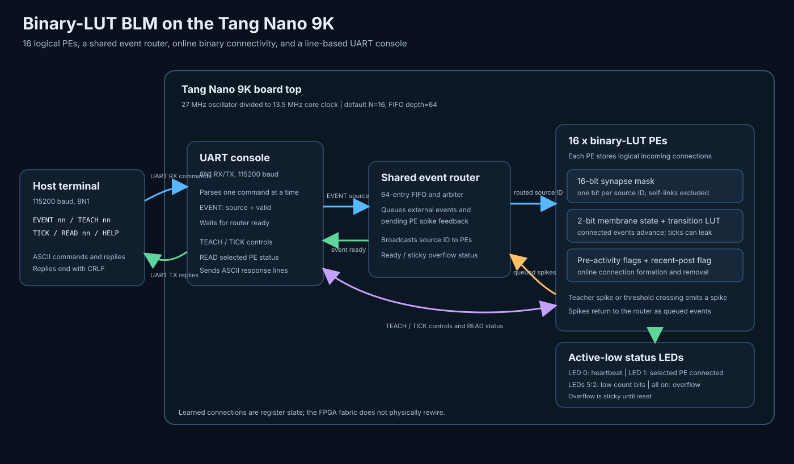
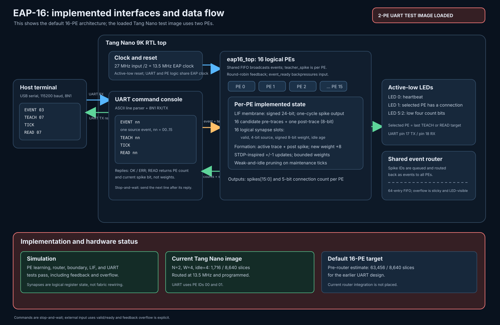
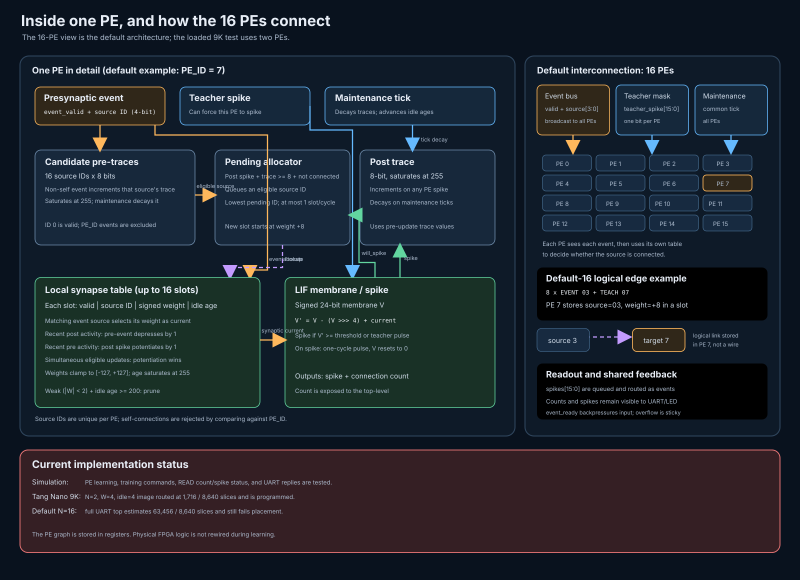

<!--
 * Copyright (c) 2026 ykat UG (haftungsbeschraenkt) - All Rights Reserved
 *
 * Permission for non-commercial use is hereby granted,
 * free of charge, without warranty of any kind.
-->

# EAP-16 — Experience-Adaptive Processor

This repository contains two separate learning-network experiments: the
adaptive EAP-16 network and the Binary-LUT BLM network. The BLM has its own
Tang Nano 9K board top; it is not the signed-weight EAP-16 design. Both keep
learned connectivity as logical state in the FPGA rather than physically
rewiring the fabric.

## Binary-LUT BLM: model overview

The default board design has 16 processing elements (PEs), each with one
logical synapse bit per possible source and a two-bit membrane state. A
combinational transition table advances or leaks the membrane state; a
connected event at the high state produces a spike. Online learning uses
per-source pre-activity flags and a recent-post flag: a postsynaptic spike
forms links to active non-self sources, while a source event after recent post
activity removes its link. Formation wins on a simultaneous update.
`TEACH nn` can force a teacher spike. The shared event router queues external
events and internal spike feedback. Unlike EAP-16, this experiment uses binary
synapses and has no weak-connection pruning.

The `blm/` folder also contains a separate bounded-context bit-sequence
predictor; it is not part of this BLM network or its board image. See
[`blm/README.md`](blm/README.md) for the BLM experiments and their limitations.



## Run the Binary-LUT BLM on a Tang Nano 9K

Building the bitstream requires GNU Make, Yosys with `synth_gowin`,
`nextpnr-gowin`, and `gowin_pack`; programming also requires
`openFPGALoader`. Install Icarus Verilog (`iverilog` and `vvp`) as well to run
the BLM simulations. From the repository root:

```sh
make -C blm test
make -C blm board-bitstream
make -C blm board-program
```

The default image uses 16 PEs, a 64-entry event FIFO, and a 13.5 MHz core
clock derived from the board's 27 MHz oscillator. The bitstream is written to
`build/blm/binary_lut_tangnano9k.fs`; `board-program` loads it over JTAG with
`openFPGALoader -b tangnano9k`. Programming is volatile, so repeat it after
power is removed. Close any serial terminal before programming.
The board pin assignments are in
[`blm/tangnano9k_binary_lut.cst`](blm/tangnano9k_binary_lut.cst).

### UART interface

After programming, connect to the Tang Nano 9K USB serial port using 115200
baud, 8 data bits, no parity, and one stop bit (8N1). Send one ASCII command
per line; the console accepts CR or LF line endings and replies with CRLF.
Wait for each reply before sending the next command. IDs are decimal from 00
through 15 for the default 16-PE image.

| Command | Action | Successful reply |
|---|---|---|
| `EVENT nn` | Inject an event from source `nn`; waits for router readiness. | `OK EVENT nn` |
| `TEACH nn` | Force a teacher spike at PE `nn`. | `OK TEACH nn` |
| `TICK` | Apply one maintenance tick. | `OK TICK` |
| `READ nn` | Select PE `nn` and read its connection count and current spike bit. | `PE nn COUNT nn SPIKE n` |
| `HELP` | List the command syntax. | Command list |

For example:

```text
HELP
EVENT 00
TEACH 01
READ 01
TICK
```

`READ` reports only the selected PE's total incoming connection count and
current spike bit; it does not return individual source connections. An
overlapping command is reported as `ERR BUSY`. The active-low LEDs show a
heartbeat on LED 0, whether the selected PE has any connections on LED 1, and
the low four count bits on LEDs 5:2. All LEDs turn on for a sticky event-router
overflow fault, which clears on reset.

**Hardware status:** the latest recorded BLM board place-and-route run used
4,135 of 8,640 slice sites (47.9%) and estimated a 16.43 MHz maximum against
the 13.5 MHz constraint. These are tool estimates, not measured board
performance. The UART command, readback, and feedback path is covered by RTL
simulation, but the latest hardware UART smoke test did not produce a reply;
end-to-end UART operation on the board is therefore not yet verified. See
[`blm/README.md`](blm/README.md) for the detailed report.

## EAP-16 network

EAP-16 is an integer-only, event-driven spiking-network RTL prototype with
signed synaptic weights. Its logical synaptic graph is stored in registers;
the FPGA fabric does not physically reconfigure itself during learning.





## Run the tests

Install Icarus Verilog (`iverilog` and `vvp`) and GNU Make, then run:

```sh
make test
```

The self-checking tests cover reset, the minimum legal PE parameters
(`N=2`, `FANIN=1`), self-connection exclusion, source ID zero, connection
formation and queued allocation, potentiation, depression, simultaneous
pre/post priority, signed weight saturation, pruning, LIF integration and
threshold behavior, 4-bit weight/idle-age parameters, and the Tang Nano 9K
UART command sequence. The event-router test covers FIFO ordering, simultaneous
feedback spikes, external-event backpressure, overflow reporting, and
top-level spike feedback. The PE test also verifies that disabling plasticity
freezes learning state while LIF membrane/spike behavior remains active.

## Compare the SNN implementations

Run the seeded classification and mapped-resource comparison with:

```sh
make benchmark
```

The benchmark requires Python 3.10+ (standard library only), Icarus Verilog,
Yosys with `synth_gowin`, and GNU Make. The number of trials and starting seed
are configurable, for example:

```sh
make benchmark BENCHMARK_TRIALS=12 BENCHMARK_SEED=20
```

The defined task is two-class event-pattern classification on 16 PEs. Class 0
uses feature sources 0–3 and class 1 uses sources 4–7; output neurons are PE 14
and PE 15. Each trial trains EAP-16 on four labeled feature-pair patterns
(two per class), then scores the four held-out pair combinations per class.
Evaluation adds a short opposite-class confuser and 0–3 unconnected distractor
events. The class with more output spikes wins; ties count as incorrect.
Plasticity is enabled during training and frozen during evaluation using
`learning_enable`. The fixed-topology baseline starts with the eight
ground-truth feature-to-class edges at weight +8, while EAP-16 starts with no
edges. The software reference is cycle-checked against the fixed RTL, including
spikes, backpressure, and overflow. The comparison uses a threshold of 100 to
make the short task observable; the RTL default remains 1000. Both network
cores use `N=16`, 8-bit weights, and a 64-entry shared event FIFO.

With the default eight seeds (1–8), the software reference, fixed-topology RTL,
and adaptive EAP-16 each classify 64/64 held-out patterns (100%; 32/32 per
class). `make benchmark-networks` adds the binary-LUT BLM network to the same
task; it also classified 64/64 (100%; 32/32 per class). These results show that
the adaptive networks learned the intended mapping for this synthetic task,
not that they outperform the fixed baseline: it is preconfigured with the
correct, stable topology.

`make benchmark` maps the fixed and adaptive cores through Yosys `synth_gowin`;
the three-way `make benchmark-networks` command maps the binary-LUT core as
well. Latest mapped primitive counts for the three network cores are:

| Model | LUT1–4 | MUX2_LUT | ALU | FF | RAM primitives | Mapped cells |
|---|---:|---:|---:|---:|---:|---:|
| Fixed-topology SNN | 1,402 | 470 | 1,200 | 543 | 4 | 3,743 |
| Adaptive EAP-16 | 36,746 | 4,825 | 20,469 | 8,351 | 4 | 70,520 |
| Binary-LUT BLM | 2,523 | 728 | 528 | 687 | 4 | 4,599 |

On this mapping, BLM uses about 1.80× the LUT1–4 cells and 1.27× the
flip-flops of the oracle fixed network, while adaptive EAP-16 uses about
14.6× BLM's LUT1–4 cells and 12.2× its flip-flops. All three tie on this task,
which does not measure learning on unknown or changing topologies. Counts are
for the network cores without the UART board wrapper, and are
synthesis-mapped primitives—not placed area, timing, power, or energy results.
The existing two-network `make benchmark` writes detailed cycle and trial
results under `build/`; the three-network comparison writes
`build/snn_binary_comparison_trials.csv`. It uses the same seeded task,
verifies that BLM learned the expected feature edges, and freezes plasticity
during held-out evaluation. The fixed-topology SNN is an oracle baseline with
the correct edges prewired; these results cover this small synthetic task,
not general SNN quality or a dense ANN.

Default `make benchmark-networks` output:

```text
Task: seeded binary event-pattern classification; 8 trials, 64 held-out patterns.
All models receive the same training/evaluation actions per seed; plasticity is frozen during evaluation.
Fixed-topology SNN is an oracle baseline with the correct 8 edges wired in advance; EAP-16 and BLM learn those edges from teacher spikes.
Classifier: larger spike count at PE 14/15 wins; ties count as wrong.
  Model                         Correct   Accuracy   Mean/trial +/- SD
  Fixed-topology SNN (RTL)       64/64   100.00%  100.00% +/- 0.00%
  Adaptive EAP-16                64/64   100.00%  100.00% +/- 0.00%
  Binary-LUT BLM                 64/64   100.00%  100.00% +/- 0.00%
Gowin-mapped network primitive counts (synthesis only):
  Model                         LUT1-4  MUX2_LUT   ALU   FFs   RAM  Cells
  Fixed-topology SNN              1402       470  1200   543     4   3743
  Adaptive EAP-16                36746      4825 20469  8351     4  70520
  Binary-LUT BLM                  2523       728   528   687     4   4599
Primitive counts are not placement, timing, power, or area results. No physical event-rate or application-scale claim is made.
Per-trial results: build/snn_binary_comparison_trials.csv
```

## Parallel BLM network experiment

The parallel-capacity wrapper
[`binary_lut_dual_array.sv`](blm/binary_lut_dual_array.sv) keeps its original
name but now has a configurable `NETWORK_COUNT` (default 2). Each 16-PE array
has its own valid/ready event input, FIFO, feedback path, learning enable,
teacher mask, and synapse state. It also exposes a 32-bit snapshot map that
can save and restore PE learning state, FIFO contents, pending feedback
counts, and router control state. For area, the separate live synapse read mux
is disabled by default; the snapshot map still contains every synapse. Set
`SYNAPSE_READ_PORT=1` to enable the flat read port addressed as
`network_id*256 + target_pe*16 + source_id`. Run the simultaneous-stream,
learning-isolation, and snapshot round-trip checks with:

```sh
make -C blm dual-network-test
```

The tests cover two and three networks. Each delivered 256 events in 257 cycles
with no stalls: **1.992 aggregate broadcasts/cycle for two arrays**, and 2.988
for three. A learning-isolation check confirmed that modifying network 0 did
not alter network 1. Snapshot tests save the complete map, corrupt learned
state, restore it, and compare the entire map for both configurations.

The dual-network placement estimate includes snapshot support and disables the
redundant flat synapse read mux by default. `make -C blm dual-network-estimate`
places the current two-array core at **7,486/8,640 slices (86.6%)** with a
31.25 MHz pre-route estimate against the 13.5 MHz constraint. This is
placement-only; an unconstrained full-route attempt did not complete. The core
has 187 top-level I/O bits and is not the Tang Nano board wrapper. The pin map,
UART snapshot controls, and final board bitstream still need integration and
validation.

## Network and synapse-width experiments

`PE_COUNT` controls the instantiated PE count (2–16, default 16). `WEIGHT_W`
and `IDLE_W` configure synapse weight and idle-age widths; their Rev 0.2
defaults are 8 bits. `EVENT_FIFO_DEPTH` defaults to 64 and must be at least 2;
it sets both the shared event FIFO depth and the per-source pending-spike
counter limit. Override them through Make:

```sh
make test PE_COUNT=2 WEIGHT_W=4 IDLE_W=4
make bitstream PE_COUNT=2 WEIGHT_W=4 IDLE_W=4
make test PE_COUNT=2 WEIGHT_W=4 IDLE_W=4 EVENT_FIFO_DEPTH=16
```

`WEIGHT_W` supports 2–8 bits and uses symmetric saturation
[-(2^(W-1)-1), +(2^(W-1)-1)]. The default initial/fixed weight scales from +8
at 8 bits to +4 at 7 bits, +2 at 6 bits, and +1 at 2–5 bits. This approximates
the same fraction of signed full scale, with a minimum nonzero positive weight.
`INITIAL_WEIGHT` and `FIXED_WEIGHT` can still be overridden explicitly.
At 3–5 bits the +1 default is below the default +2 `MIN_WEIGHT`; an unused
connection can therefore be pruned after its idle age reaches `PRUNE_AGE`.
`IDLE_W` supports 1–8 bits; its default prune age is 200 ticks at 8 bits and
the maximum representable age at narrower widths. Width changes alter learning
dynamics and PE-count changes alter network capacity; each configuration
needs simulation and place-and-route validation. The previously measured
default 16-PE UART image did not fit the Tang Nano 9K; that estimate predates
the shared router (see the hardware status below).

## Build and program the adaptive EAP-16 Tang Nano 9K target

These root-level targets build the adaptive EAP-16 design, not the
Binary-LUT BLM board image described above. Use the `make -C blm` commands in
that section to build and program the BLM target.

The open-source FPGA flow needs Yosys with `synth_gowin`, `nextpnr-gowin`,
`gowin_pack`, and `openFPGALoader`:

```sh
make bitstream
make program
```

When the board target fits, `make bitstream` writes
`build/eap16_tangnano9k_n16_w8_i8_q64.fs` with the default parameters, and
`make program` loads it over JTAG. Programming is volatile and must be repeated
after power is removed. Close the serial terminal before programming the board.
To load the fitted two-PE experiment, run
`make program PE_COUNT=2 WEIGHT_W=4 IDLE_W=4 EVENT_FIFO_DEPTH=64`.

The 27 MHz board clock is divided by two for the EAP core (13.5 MHz), below
the configured timing target. The UART uses 115200 baud, 8 data bits, no parity,
and one stop bit (8N1). When a UART-enabled bitstream is available, connect to
the Tang Nano 9K's USB serial port, then send one command at a time and wait
for its response:

```text
EVENT 00
EVENT 00
... repeat until eight EVENT commands have been acknowledged ...
TEACH 01
READ 01
```

`EVENT nn` injects one source event, `TEACH nn` injects a teacher spike at a
PE, `TICK` advances maintenance by one cycle, `READ nn` reports that PE's
connection count and current spike bit, and `HELP` lists the commands. IDs are
decimal from 00 through `PE_COUNT-1` (up to 15). The UART does not currently
return individual synapse sources or weights; those are checked in simulation.

The currently programmed pre-router two-PE, 4/4-bit image used the old +7
initial-weight fallback; the current RTL default for a 4-bit weight is +1.
With the default 16-PE, 8/8-bit configuration, the initial weight remains +8.
A later teacher spike can potentiate a connection while its candidate trace
remains active. A `TICK` decays traces and ages connections. The host should
wait for each text reply before sending another command; an overlapping
command is discarded and reported as `ERR BUSY`.

- LED 0 blinks as a heartbeat.
- LED 1 turns on when the most recently selected PE has at least one incoming
  connection.
- LEDs 5:2 show the low four bits of that PE's connection count.
- LEDs are active-low.
- All six LEDs turn on if the event router reports feedback-counter overflow;
  this sticky fault clears on reset.

The board uses UART TX on pin 17 and RX on pin 18, plus its 27 MHz oscillator,
active-low reset, and six LEDs. Pin assignments are in
[`constraints/tangnano9k.cst`](constraints/tangnano9k.cst).

**Current hardware status:** the previously measured default 16-PE UART image
did not place on the GW1NR-9C (63,456/8,640 slices); that estimate predates the
shared event router and is not a measurement of the current RTL. The
configurable `PE_COUNT=2 WEIGHT_W=4 IDLE_W=4` image placed at 1,716/8,640
slices and is currently programmed; it also predates the router. The current
16-PE network cores have been Gowin-mapped for the comparison, but the UART
board top has not been placed or timing-closed with the router.

## Project layout

- [`rtl/eap_dynamic_pe.sv`](rtl/eap_dynamic_pe.sv) — LIF state, synapses,
  candidate traces, learning, formation, and pruning for one PE.
- [`rtl/eap16_event_router.sv`](rtl/eap16_event_router.sv) — shared event FIFO,
  round-robin arbitration, and per-source feedback-spike staging.
- [`rtl/eap16_top.sv`](rtl/eap16_top.sv) — routed 16-PE network integration.
- [`rtl/eap16_fixed_topology_top.sv`](rtl/eap16_fixed_topology_top.sv) —
  static-connectivity LIF RTL baseline for comparisons.
- [`learning_enable`](rtl/eap16_top.sv) gates online plasticity; the board top
  holds it high, while the benchmark disables learning for held-out evaluation.
- [`rtl/eap16_uart_console.sv`](rtl/eap16_uart_console.sv),
  [`rtl/uart_rx.sv`](rtl/uart_rx.sv), and [`rtl/uart_tx.sv`](rtl/uart_tx.sv) —
  UART commands, receive, and transmit.
- [`rtl/eap16_tangnano9k_top.sv`](rtl/eap16_tangnano9k_top.sv) — board
  UART interface and LED status.
- [`blm/binary_lut_tangnano9k_top.sv`](blm/binary_lut_tangnano9k_top.sv) and
  [`blm/README.md`](blm/README.md) — separate Binary-LUT BLM board top and
  learning experiments.
- [`tb/`](tb) — self-checking SystemVerilog testbenches.
- [`tb/tb_snn_comparison.sv`](tb/tb_snn_comparison.sv) and
  [`tools/compare_snn.py`](tools/compare_snn.py) — common-workload simulation
  comparison and integer software reference.
- [`docs/DESIGN.md`](docs/DESIGN.md) — architecture and limitations.
- [`docs/binary-lut-blm-overview.svg`](docs/binary-lut-blm-overview.svg) —
  BLM board and UART data-flow diagram.
- [`docs/eap16-implemented-interfaces.svg`](docs/eap16-implemented-interfaces.svg)
  — current interface and data-flow diagram.
- [`docs/eap16-pe-detail.svg`](docs/eap16-pe-detail.svg) — PE internals and
  logical network connections.

## Current limitations

The shared FIFO defaults to 64 entries. A round-robin arbiter accepts either a
valid external event or one queued internal spike per cycle, and broadcasts
the FIFO head to all PEs. External producers must hold `event_valid` and
`event_source` stable until `event_ready` is asserted. Feedback spikes are
counted per source while waiting for arbitration; if a per-source counter
fills, `event_overflow` latches until reset and the incoming spike cannot be
retained. This bounded-overload fault is shown by all LEDs turning on. UART
`READ` does not return individual weights. Teacher spikes are still a training
aid. `learning_enable=0` freezes traces and synapse formation, weight, age, and
pruning updates while the membrane and spike path continues to run. The board
ties this input high, preserving its existing online-learning behavior.
Simulation passing does not establish general task accuracy, timing, power, or
application performance.

## Validation report

Validated in this workspace:

- The PE, parameter-boundary, event-router, UART command/readback, and board
  tests pass with Icarus Verilog 12.0-2+b1.
- `make benchmark PYTHON=/usr/bin/python3` passes with Python 3.13.5,
  Icarus Verilog 12.0-2+b1, and Yosys 0.52. The fixed software reference
  matches the fixed RTL; all three models score 64/64 on the specified
  synthetic task.
- Yosys `synth_gowin` mapped both 16-PE comparison network cores; see the
  benchmark table above. No place-and-route run was made for these variants.
- Yosys 0.52 structural check for `N=2`, `FANIN=1`, and
  `EVENT_FIFO_DEPTH=4`:
  ```sh
  yosys -Q -p "read_verilog -sv rtl/eap_dynamic_pe.sv rtl/eap16_event_router.sv rtl/eap16_top.sv; \
    chparam -set N 2 -set FANIN 1 -set EVENT_FIFO_DEPTH 4 eap16_top; \
    hierarchy -check -top eap16_top; proc; check"
  ```
  reports zero structural problems. This is not a full synthesis, placement,
  timing, or area result.
- Yosys 0.52-2 maps the standalone UART console to about 790 LUT cells and 178
  flip-flops. This is separate from the PE array and is not a full-board area
  result.
- The pre-router `PE_COUNT=2 WEIGHT_W=4 IDLE_W=4` image placed at
  1,716/8,640 slices, passed the 13.5 MHz timing check, and was loaded to the
  attached GW1N(R)-9C; openFPGALoader 0.13.1-1 reported DONE. This is the
  currently loaded image, not the current routed RTL.
- The pre-router default-width 16-PE UART target failed placement at
  63,456/8,640 slices with nextpnr-gowin 0.7-1+b2. This does not measure the
  current router integration. The earlier fixed demo did not prove the full
  16-PE network fit.
