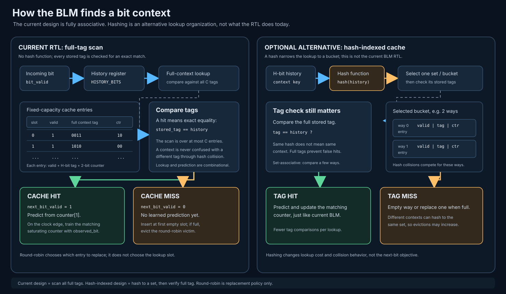

<!--
 * Copyright (c) 2026 ykat UG (haftungsbeschraenkt) - All Rights Reserved
 *
 * Permission for non-commercial use is hereby granted,
 * free of charge, without warranty of any kind.
-->

# BLM: FPGA learning experiments

This folder contains two standalone synthesizable experiments:

- [`bit_sequence_learner.sv`](bit_sequence_learner.sv): an online,
  bounded-context next-bit predictor, not a language model.
- [`binary_lut_pe.sv`](binary_lut_pe.sv): a binary-synapse PE with a small
  LUT-style membrane transition function.

Neither is integrated with the EAP network or UART.

## Context-table bit-sequence learner

`HISTORY_BITS` defaults to 4 and must be in the range 2 through 12.
`CACHE_ENTRIES` defaults to 32 and must be in the range 1 through 64. The
fixed-capacity, fully associative cache stores a valid bit, the complete
`HISTORY_BITS`-wide context tag, and a 2-bit saturating successor counter per
entry. Its state grows as `CACHE_ENTRIES * (HISTORY_BITS + 3)` bits rather than
`2**HISTORY_BITS` counters, plus history, control, and replacement-pointer
state. The fully associative lookup compares the bounded set of tags each
cycle.

On a cache hit, the counter's high bit is the prediction; observing a successor
`1` increments the counter and `0` decrements it. Counters saturate at
`2'b00` and `2'b11`. A miss has no learned prediction (`next_bit_valid=0`,
`next_bit_prediction=0`); the observed successor installs a new entry with
that first observation applied. Allocation uses the first invalid entry, then
round-robin replacement when full. Hits do not move the replacement pointer.
Reset clears the cache and history.

`next_bit_prediction` is available before the next input bit is accepted, and
`next_bit_valid` is high only when the history is full and its tag is cached.
Assert `bit_valid` for each observed bit. Assert `sequence_start` with the
first bit of a new sequence to clear history without clearing cached learning;
the first `HISTORY_BITS` bits seed context without training across the boundary.
Asserting `sequence_start` without `bit_valid` also clears history. Idle clock
cycles do not change the model; it learns bit order, not elapsed time. A UART
decoder would need to deliver each payload bit using `bit_valid`.

This is bounded-order learning, not truly unbounded arbitrary-sequence
learning. At the default setting, it can learn next-bit mappings determined by
the previous four bits, while retaining at most 32 contexts. If more distinct
contexts occur, round-robin replacement forgets older ones. A larger context
helps only when earlier bits disambiguate successors.



Run the self-checking simulations with:

```sh
make -C blm test
```

This tests the minimum (`HISTORY_BITS=2`), default (`4`), and maximum (`12`)
history lengths, plus miss handling and round-robin eviction in a two-entry
cache; the maximum history test also uses the maximum 64-entry cache. Run the
default four-bit-context accuracy benchmark with:

```sh
make -C blm benchmark
```

The benchmark trains and then scores streams online, counting each prediction
before learning from that bit. It excludes the first four bits of each scored
sequence and compares against a constant-zero baseline. In addition to
alternating `0101` and repeated `0011`, the order-4 de Bruijn sequence covers
all 16 four-bit contexts. These are simulation results, not FPGA throughput or
hardware resource measurements.

## Binary-synapse LUT PE experiment

[`binary_lut_pe.sv`](binary_lut_pe.sv) is a standalone PE variant; it does not
replace or connect to EAP-16. Its two-bit membrane register is advanced by an
explicit 16-row transition table indexed by membrane state, binary synaptic
input, and maintenance tick. Synthesis maps that table to FPGA logic; the
registers still hold the membrane state. The state advances `0 -> 1 -> 2`;
a connected event in state 2 spikes and resets to 0. A maintenance tick
decrements the state when there is no connected event, and an event takes
priority over a simultaneous tick. `teacher_spike` also forces a spike/reset.

Synapses are a one-bit-per-source connection mask. A connected event adds one
membrane step; a maintenance tick leaks one step when there is no connected
event. Each source has a one-bit pre-activity flag, set by an event and cleared
by a maintenance tick, plus one bit for recent post activity. A postsynaptic
spike forms connections for flagged non-self sources; a presynaptic event
after recent post activity disconnects that source. Formation wins on a
simultaneous formation/depression.
`learning_enable=0` freezes flags and synapses while membrane updates continue.
The parameters require `N >= 2` and `0 <= PE_ID < N`; an out-of-range event ID
selects no synapse. This variant is excitatory-only and omits idle pruning;
both are deliberate differences from the signed-weight EAP PE.

The binary PE simulation is included in `make -C blm test`. Run
`make -C blm fpga-check` for generic synthesis and structural checking, or
`make -C blm fpga-place` for Gowin mapping and placement without routing. For
the standalone `N=16` PE, Yosys 0.52 mapped 196 LUT1-LUT4 cells and 34
flip-flops; nextpnr-gowin 0.7 placed it at 215/8,640 slice sites. This
top-level experiment exposes the synapse mask and membrane state for
inspection. The no-route report has no timing result and does not establish
how many PEs fit after adding a shared router.

Run the 16-PE network benchmark with:

```sh
make -C blm network-benchmark
```

It checks ordered delivery of a saturated event burst and a teacher-supervised
source-0-to-PE-1 connection followed by an induced spike and feedback event.
It reports cycle-level router throughput and learning-path latency. These are
RTL simulation measurements; do not interpret them as physical UART
throughput or application accuracy.

Latest run (Icarus Verilog 12.0): all 256 offered events were accepted and
delivered in 257 cycles, with zero stalls or overflow (`0.996` broadcasts per
cycle including startup and drain; the steady-state router limit is one
broadcast per cycle). The supervised path formed source 0 to PE 1; three
subsequent source-0 events produced one PE-1 spike 12 cycles after the initial
candidate event, and that spike was routed back as one event.

The full Tang Nano 9K top (16 PEs, shared FIFO, UART, and status logic) placed
and routed at 6,045/8,640 slices (70.0%). nextpnr-gowin estimated a 14.59 MHz
maximum for `eap_clk` against the 13.5 MHz constraint. At the constrained clock,
one event broadcast per cycle corresponds to a theoretical 13.5 million
network broadcasts/s (216 million PE-event updates/s across 16 PEs). This is
derived from the RTL rate and timing estimate, not a measured board throughput
or power result. The board heartbeat is active, but the UART hardware smoke
test has not produced a reply; physical end-to-end operation remains
unverified.

## Compare against EAP-16 and fixed topology

From the repository root, run `make benchmark-networks` to compare the binary
LUT network, adaptive EAP-16, and the fixed-topology SNN on the same seeded
event-pattern task. The default run uses eight seeds and scores eight held-out
patterns per seed:

```text
Task: seeded binary event-pattern classification; 8 trials, 64 held-out patterns.
All models receive the same training/evaluation actions per seed; plasticity is frozen during evaluation.
Fixed-topology SNN is an oracle baseline with the correct 8 edges wired in advance; EAP-16 and BLM learn those edges from teacher spikes.
Classifier: larger spike count at PE 14/15 wins; ties count as wrong.
  Model                         Correct   Accuracy   Mean/trial +/- SD
  Fixed-topology SNN (RTL)       64/64   100.00%  100.00% +/- 0.00%
  Adaptive EAP-16                64/64   100.00%  100.00% +/- 0.00%
  Binary-LUT BLM                 64/64   100.00%  100.00% +/- 0.00%
Gowin-mapped network primitive counts (synthesis only):
  Model                         LUT1-4  MUX2_LUT   ALU   FFs   RAM  Cells
  Fixed-topology SNN              1402       470  1200   543     4   3743
  Adaptive EAP-16                36746      4825 20469  8351     4  70520
  Binary-LUT BLM                  3049       648  1168   687     4   5681
Primitive counts are not placement, timing, power, or area results. No physical event-rate or application-scale claim is made.
Per-trial results: build/snn_binary_comparison_trials.csv
```

The fixed-topology model is an oracle baseline with the correct connections
prewired, so equal accuracy does not show that learning improves this task.
The benchmark uses teacher-labeled training and a small synthetic workload;
it is not a general SNN quality test or a comparison to a dense ANN. Primitive
counts are for synthesis-mapped network cores, not placed area or timing.
